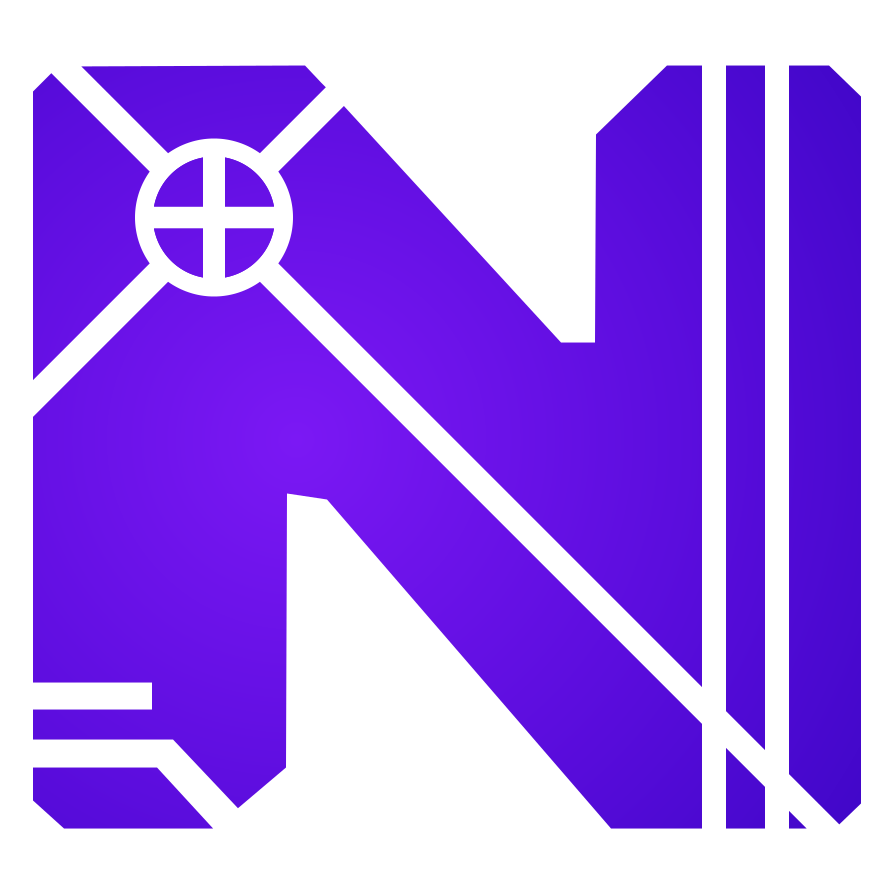

<p align="center"></p>

# Nemerle (revived)

**Nemerle, revived and extended: a complete language for the whole .NET ecosystem, so you don't have to write C#.**

Nemerle is a statically typed language for .NET. It combines functional, object-oriented and imperative programming,
infers types, and has a macro system strong enough to grow the language itself. It was well ahead of its time when the
University of Wroclaw created it in 2003. This repository brings it back on **.NET 10** and carries its ideas further:
grammars and spaces built into the language, scripting a host can extend, projects and NuGet packages, output for
older .NET, .NET Framework, Mono and the mobile and desktop platforms, and an editor and debugger of its own. Every
.NET library is yours to use, and what you write in Nemerle is an ordinary .NET library to everyone else.

```nemerle
using System.Console;

variant Shape
{
  | Circle { radius : double }
  | Rectangle { width : double; height : double }
}

Area(shape : Shape) : double
{
  | Shape.Circle(r) => 3.14 * r * r
  | Shape.Rectangle(w, h) => w * h
}

foreach (shape in [Shape.Circle(1.0), Shape.Rectangle(2.0, 3.0)])
  WriteLine(Area(shape))
```

## Goals

- **A living Nemerle.** The original work went quiet after 2015, on .NET Framework and Mono. Here it runs on today's
  .NET and builds itself from source, so it can keep evolving.
- **Extensible, and disciplined.** You can extend the language with macros and with whole grammars (`grammar` and
  `space`). The structure stays predictable:
  - a source file is its namespace, so there is no namespace spaghetti;
  - a file uses each grammar in one place;
  - language extensions are always published as source, so nobody ships a private dialect that users mistake for
    Nemerle.
- **Tooling you can rely on.**
  - one install for the compiler, scripts and a language server for any editor;
  - scripts that configure themselves the way Kotlin's do;
  - compiled grammars and macros that travel inside the libraries that define them.
- **Classic Nemerle stays Nemerle.** Only `namespace` blocks and `partial` are gone; everything else of the classic
  language works. Where the compiler behaves differently from classic Nemerle in other ways, that's treated as a bug.

## Install

Clone the repository and run the installer for your system. On Windows it installs a missing **.NET 10 runtime**
through winget and continues in the same terminal. On Linux and macOS, install the runtime first
([download](https://dotnet.microsoft.com/download/dotnet/10.0)):

```sh
git clone https://github.com/AZELCALT/Neo-Nemerle.git
cd Neo-Nemerle
install/install.sh            # Linux, macOS (sh)
```

```bat
install\install.cmd           :: Windows (Command Prompt or PowerShell)
```

The installer:
1. stages the toolchain (compiler, standard library and macros, Nitra, scripting) in a folder of your own and verifies
   that `System.CodeDom.dll` matches the compiler;
2. builds the language server from source with that compiler;
3. puts `ncc`, `nscript` and `nemerle-lsp` on your `PATH`;
4. writes the VS Code / VSCodium extension as `install/nemerle-0.2.0.vsix` (it carries its language server; install
   it by hand with *Extensions → … → Install from VSIX*), and installs it in the editor it finds;
5. compiles and runs a small program and runs a script before replacing the previous toolchain or changing PATH.

| | Linux / macOS (`install.sh`) | Windows (`install.cmd`, `install.ps1`) |
|---|---|---|
| Installs to | `~/.local/share/nemerle` (`--prefix`) | `%LOCALAPPDATA%\Nemerle` (`-Prefix`) |
| Commands go to | `~/.local/bin` (`--bin`) | `%LOCALAPPDATA%\Nemerle\bin`, added to your user `PATH` |
| Build from source first | `--build` | `-Build` |
| Skip the language server | `--no-lsp` | `-NoLsp` |
| Skip the debugger (netcoredbg, fetched for the extension) | `--no-debugger` | `-NoDebugger` |
| Use existing prerequisites; disable automatic prerequisite installation and online CodeDOM repair | — | `-NoDependencies` |
| Editor extension (`none`: only the `.vsix`) | `--editor auto\|code\|codium\|none` | `-Editor auto\|code\|codium\|none` |
| Remove everything | `--uninstall` | `-Uninstall` |

`install/install.ps1` also runs under PowerShell 7 on Linux and macOS. The Windows-specific parts (`.cmd` launchers, the
user `PATH`) have not been tested on Windows yet; please report problems.

On Windows, `-Build` installs a missing .NET 10 SDK, Python 3, Mono's strong-name verification tool and Git through winget.
If winget itself is missing, the installer attempts to bootstrap it with Microsoft's `Microsoft.WinGet.Client`
PowerShell module. It refreshes PATH after installing prerequisites; Windows may still ask for elevation for the
system packages. An explicitly selected missing editor (`-Editor code` or `-Editor codium`) is installed through
winget too. The extension normally fetches its locked JavaScript dependencies directly; if that fails and npm is
missing, Windows installs Node.js LTS before retrying.

CodeDOM is an app-local dependency: the installer checks the compiler's assembly reference, uses a matching bundled
DLL, and repairs a missing or incompatible copy from the matching NuGet package when necessary. It does not replace
that DLL with an arbitrary SDK's copy. Builds select .NET 10 even when a newer major SDK/runtime is installed, and
preserve paths containing spaces. If the pinned compiler cannot build this checkout's language server, installation
rebuilds a matching source toolchain once rather than leaving half an install (`-NoDependencies` disables that retry).

Source-build logs are kept in `<Prefix>/build/logs`; dependency installation is logged to `<Prefix>/dependencies.log`.
Prerequisites installed through winget are shared system/user tools and are left in place when Nemerle is uninstalled.

On Linux, `install.sh` also registers file-manager icons for `.n`, `.ns` and `.nproj` (silver for projects). To install
just these icons, run `sh install/install-file-icons.sh`; remove them with the same command plus `--uninstall`.
This uses the user's XDG data directory and needs `update-mime-database` from `shared-mime-info`.

**Without installing**, everything also runs straight from the clone: `boot/coreclr/ncc` and `boot/coreclr/nscript`.

### Editors

The language server speaks LSP over stdio. It gives diagnostics (typed ones for the whole workspace), semantic
highlighting, folding, document symbols, hover, go-to-definition, completion, find-references and rename, including
inside `grammar` and `space` blocks; the VS Code / VSCodium extension also debugs through netcoredbg.
- **VS Code / VSCodium:** the installer sets up the extension. It runs `nemerle-lsp` from `PATH`, or the
  `nemerle.languageServer.path` setting.
- **The extension on its own:** `./bootstrap` also writes `out/bootstrap/nemerle-0.2.0.vsix` (or run
  `build/build-vscode-extension.py`). It carries its language server and needs only the .NET 10 runtime:
  `code --install-extension nemerle-0.2.0.vsix`, `codium --install-extension nemerle-0.2.0.vsix`, or
  *Install from VSIX...* in the Extensions view.
- **Other editors:** configure an LSP client to start `nemerle-lsp` for `*.n` files.

Details are in [tools/language-server/README.md](tools/language-server/README.md).

## Your first program

```sh
echo 'System.Console.WriteLine("Hello, world!")' > hello.n
nscript run hello.n              # run it as a script
ncc hello.n -out:hello.exe       # or compile it, with a launcher:
./hello                          # (hello.exe on Windows, the program then in hello.dll)
```

A compiled program needs `Nemerle.dll`, the standard library, next to it when it uses the library. Find it in the
installed toolchain folder.

For more than one file, make a project: `ncc init hello && cd hello && ncc run`. The `.nproj` file names the
project and lists its references (assemblies, other projects, NuGet packages); `ncc build` puts a ready-to-run
program, with `Nemerle.dll` and its references, in `out/`. See [Projects](doc/book/src/13-projects.md).

## Learn more

- **[The Nemerle Book](doc/book/src/SUMMARY.md):** the language from the ground up, from values and functions to
  pattern matching, files as modules, macros, grammars and scripts. Every example in it is compiled and tested.
  Build HTML with `python3 build/build-book.py` (Windows: `py -3 build/build-book.py`); it uses a verified prebuilt
  mdBook executable, with no Rust or Cargo installation. See the [book build instructions](doc/book/README.md).
- **[CHANGELOG.md](CHANGELOG.md):** what this revival changed compared with upstream Nemerle.
- **Reference notes:**
  - [doc/FILE-MODULES.md](doc/FILE-MODULES.md) for files as modules;
  - [doc/CONTINUATION.md](doc/CONTINUATION.md) for the continuation section;
  - [scripting/README.md](scripting/README.md) for the scripting API.

## Building from source

Building needs the .NET 10 SDK, Python 3 and `sn` (Mono's strong-name tool, which verifies signed outputs).

```sh
./bootstrap                  # boot/coreclr -> stage 1 -> stage 2, Nitra, scripting, LSP, then every test suite
./bootstrap --quick          # fast suites only
./bootstrap --update-boot    # also replace boot/coreclr with the result when everything passed
```

The new toolchain lands in `out/bootstrap/toolchain`, with one log per step in `out/bootstrap/logs`. `boot/coreclr` is
the pinned compiler that every build starts from; update it only when a bootstrap passes.

| Directory | Contents |
|---|---|
| `ncc/`, `lib/`, `macros/` | compiler, standard library, standard macros |
| `native-nitra/`, `grammar/` | Nitra (runtime, grammar, compiler) as file modules; grammar/space notes and examples |
| `scripting*/`, `tools/language-server/` | scripting host, NuGet adapter, language server and VS Code extension |
| `platform/` | CLR backend adapter (C#) |
| `install/` | the installers |
| `build/` | build scripts and `bootstrap.py`; `build/migrations/` holds the one-off source migrations |
| `tests/`, `testsuite/` | test suites and fixtures; upstream's language testsuite |
| `boot/coreclr/` | pinned .NET 10 toolchain used to bootstrap |
| `doc/` | the book, reference notes, and `doc/revive/` with the notes from the port |
| `misc/` | signing keys, editor modes |
| `legacy/` | upstream's .NET Framework / Mono / Visual Studio build files and side projects, kept unchanged ([legacy/README.md](legacy/README.md)) |

The original upstream README (Windows installer, Mono, Visual Studio) is kept in
[doc/ORIGINAL-README.md](doc/ORIGINAL-README.md). Those instructions are for the original .NET Framework tree.

## How it is built, and what is supported

The language is designed by azelcalt and built with an AI assistant (Claude): the design, the architecture and
every decision are the maintainer's, the AI implements, and nothing lands without `./bootstrap` passing (the
toolchain rebuilt from source, checked to rebuild itself, and every test suite and book example run).
[doc/HOW-IT-IS-BUILT.md](doc/HOW-IT-IS-BUILT.md) gives the details.

**What is supported is what is declared** in the book and the documentation. The open edges in
[doc/GAPS.md](doc/GAPS.md), undocumented behaviour and the compiler's internals may change or break without notice:
code that relies on them may not work in a later version.

## The people behind Nemerle

Everything here stands on the work of the original team, and the revival exists because that work was good enough
to bring back.

- **Nemerle was born at the University of Wroclaw.** The first commit in this history dates from September 2003.
  It was led by **Michal Moskal**, with **Kamil Skalski** and **Pawel Olszta**. Dawid Duda wrote the standard library,
  and Ewa Dacko, Bartosz Podlejski, Jacek Sliwerski, Wojtek Knapik and many others contributed. See [AUTHORS](AUTHORS).
- **The Nemerle Project Team and the [RSDN](https://rsdn.org) community** carried it from 2008 on. They added the
  Visual Studio integration, the PEG parser, computation expressions and much more. The busiest years were 2010 and
  2011, with about a thousand commits each.
- **[Nitra](https://github.com/rsdn/nitra)**, the language workbench published under the same RSDN organization
  (copyright JetBrains, 2014), supplies the grammar machinery this fork builds into the language.

The most active committers in the upstream history, by git handle: malekith, nazgul, VladD2, hardcase, olszta,
CodingUnit, NN, Dmitry Ivankov, rampelstinskin, rzyj, Pavel Bludov, earendil and Igor Tkachev. Hundreds of commits
by others are kept in this repository's history too (`git shortlog -sn master`).

Upstream development went quiet after 2015. This fork picks up where they stopped. Thank you.

## License

The compiler is **GPL-2.0-or-later** with an output exception: programs you compile with it are yours, under any
license you choose. Language extensions are the exception: macros and Nitra grammars change the language itself,
so their source must be published under the GPL, also when they are part of a closed program. The standard library
stays **BSD-3-Clause** like the original, so it can ship inside your programs. The original Nemerle and Nitra copyright notices are kept with their
code. See [NOTICE.md](NOTICE.md) for the full map.
